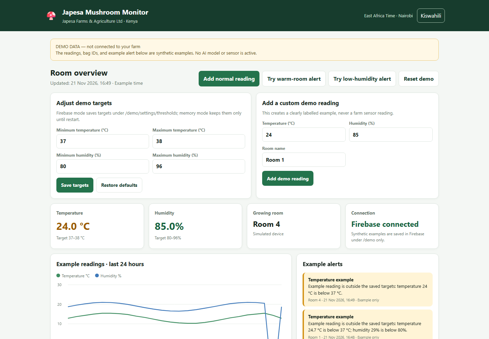

# AI Mushroom Monitor — Prototype

**Author:** Brian Otieno Odhiambo  
**Supervisor:** Fredrick Omondi  
**Organization:** Japesa Farms & Agriculture Ltd  
**Course:** Bachelor of Science in Data Science

## What this prototype shows

A dashboard prototype for a Kenyan oyster mushroom farm. It displays example room readings, a 24-hour trend, sample alerts, and sample bag checks. You can change the demo targets and add custom synthetic readings; the dashboard shows how the status and alerts respond. It displays Nairobi local time (EAT, UTC+3) and includes English and Kiswahili labels.

## Live presentation demo

Open the deployed dashboard at **[mushroom-monitor-demo.onrender.com](https://mushroom-monitor-demo.onrender.com/)**.



*The screenshot shows synthetic presentation data, not live farm sensor readings. The public demo stores its examples in the Firebase `/demo` node.*

**Every displayed reading and bag check is synthetic demo data.** The prototype is not connected to farm sensors. The deployed presentation demo stores example readings, alerts, and adjustable targets in Firebase under `/demo`; local runs can use memory or Firebase. It does not send email or SMS. Photo AI is intentionally inactive because no labeled farm photos or trained model were supplied.

## Run on Windows

Python 3.10–3.12 is required. This repository already has a Python 3.11 virtual environment in `.venv`.

In PowerShell, from the repository folder:

```powershell
.\.venv\Scripts\python.exe backend\app.py
```

Then open `http://127.0.0.1:5000/`. Or double-click `Start-Prototype.bat` to start the backend and open the dashboard. Stop it by closing the process from Task Manager or use Ctrl+C if started directly in PowerShell.

In local memory mode, simulated readings reset when the app restarts. Firebase mode stores presentation examples in the `/demo` node. The local server binds to this PC only. Do not use it as a production farm monitor.

## Kenyan defaults

- Time zone: `Africa/Nairobi` (East Africa Time, UTC+3).
- Example growing conditions: 22–26 °C and 80–90% humidity; confirm these with the farm agronomist.
- Future Kenyan phone numbers should be configured in international E.164 format such as `+254…`; this prototype stores no phone numbers.
- Future costs should be reviewed in Kenyan shillings (KES); no provider or cost is configured in this demo.

## Prototype API

- `GET /health` — confirms the local demo is running.
- `GET /api/dashboard` — returns the synthetic demo view data.
- `POST /api/simulate` — accepts `{"scenario":"normal"}`, `warm`, or `dry` to add a synthetic reading.
- `POST /api/thresholds` — saves adjustable synthetic-demo targets.
- `POST /api/demo/reading` — adds a custom synthetic temperature, humidity, and room reading.
- `POST /api/demo/reset` — resets the demo state.
- `POST /api/predict` — returns 503 until a real model is available.

For Firebase setup, see `docs/FIREBASE_DEMO_SETUP.md`. More detail and limitations: `docs/PROTOTYPE.md`.

To publish a temporary public presentation demo, follow `docs/DEPLOY_DEMO.md`. It uses memory-only synthetic examples and is not a production farm monitor.
